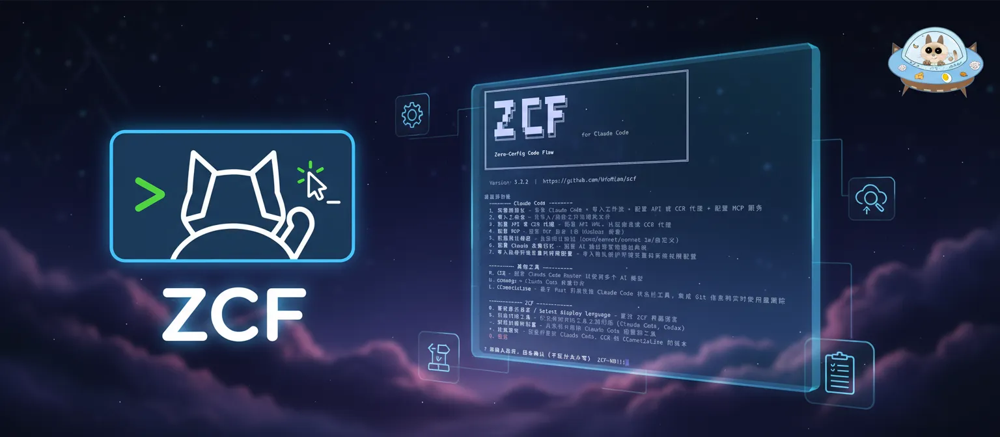

[![npm version][npm-version-src]][npm-version-href]
[![npm downloads][npm-downloads-src]][npm-downloads-href]
[![License][license-src]][license-href]
[![Claude Code][claude-code-src]][claude-code-href]
[![codecov][codecov-src]][codecov-href]
[![JSDocs][jsdocs-src]][jsdocs-href]
[![Ask DeepWiki][deepwiki-src]][deepwiki-href]

<div align="center">
  

  <h1>
    ZCF - Zero-Config Code Flow
  </h1>

  <p align="center">
    <a href="README.md">English</a> | <b>中文</b> | <a href="README_ja-JP.md">日本語</a> | <a href="CHANGELOG.md">更新日志</a>

**✨ 完整文档**: [文档入口](https://zcf.ufomiao.com/zh-CN/)

> 一份配置，管好你所有的 AI 编程工具。ZCF 安装你选择的工具，并写入每个工具自己的设置。
  </p>
</div>

> [!IMPORTANT]
> 这是尚未发布的重写版本 **ZCF v5**。正式发布前，`npx zcf` 安装的仍是 v3（源码见 [`zcf@3.7.3`](https://github.com/UfoMiao/zcf/tree/zcf@3.7.3) 标签），[zcf.ufomiao.com](https://zcf.ufomiao.com/zh-CN/) 介绍的也是 v3。想从源码试用 v5，见[参与贡献](docs/zh-CN/guide/contributing.md)。

## 🚀 快速开始

你只需维护一份 ZCF 配置：供应商、MCP 服务和技能。ZCF 会安装你选择的工具，并用各工具自带的命令（例如 `claude mcp add-json` 和 `npx skills add`）写入它们自己的设置。

支持的工具：Claude Code、Codex、Gemini CLI、OpenCode、Cursor CLI、Pi 和 DeepSeek Harness。

v5 发布后：

```bash
npx zcf            # 在终端中编辑配置
npx zcf ui         # 或在浏览器中编辑
npx zcf plan       # 查看每条命令，以及 ZCF 将修改的每个文件的 diff
npx zcf apply -y   # 安装缺少的工具并写入设置
npx zcf update     # 用各工具自带的更新命令更新
```

应用之前不会有任何改动。ZCF 只修改它管理的键，保留你的注释和格式，修改前备份每个文件，并且从不显示你的密钥。从 v3 升级？见[从 v3 迁移](docs/zh-CN/guide/v3.md)。

## 📖 完整文档

- [快速开始](docs/zh-CN/guide/index.md)、[配置文件](docs/zh-CN/guide/config.md)、[命令](docs/zh-CN/guide/commands.md)和[工具](docs/zh-CN/guide/tools.md)
- 架构说明：[ADR 002](docs/adr/002-v5-architecture.md)

## 💬 社区

加入我们的 Telegram 群组，获取支持、参与讨论和接收更新：

[](https://t.me/ufomiao_zcf)

## 📄 许可证

[MIT License](LICENSE)

---

## 🚀 贡献者

<a href="https://github.com/UfoMiao/zcf/graphs/contributors">
  
</a>
<br /><br />

## ⭐️ Star 历史

如果这个项目对你有帮助，请给我一个 ⭐️ Star！
[](https://star-history.dera.page/#UfoMiao/zcf&type=date)

<!-- Badges -->

[npm-version-src]: https://img.shields.io/npm/v/zcf?style=flat&colorA=080f12&colorB=1fa669
[npm-version-href]: https://npmjs.com/package/zcf
[npm-downloads-src]: https://img.shields.io/npm/dm/zcf?style=flat&colorA=080f12&colorB=1fa669
[npm-downloads-href]: https://npmjs.com/package/zcf
[license-src]: https://img.shields.io/github/license/ufomiao/zcf.svg?style=flat&colorA=080f12&colorB=1fa669
[license-href]: https://github.com/ufomiao/zcf/blob/main/LICENSE
[claude-code-src]: https://img.shields.io/badge/Claude-Code-1fa669?style=flat&colorA=080f12&colorB=1fa669
[claude-code-href]: https://claude.ai/code
[codecov-src]: https://codecov.io/gh/UfoMiao/zcf/graph/badge.svg?token=HZI6K4Y7D7&style=flat&colorA=080f12&colorB=1fa669
[codecov-href]: https://codecov.io/gh/UfoMiao/zcf
[jsdocs-src]: https://img.shields.io/badge/jsdocs-reference-1fa669?style=flat&colorA=080f12&colorB=1fa669
[jsdocs-href]: https://www.jsdocs.io/package/zcf
[deepwiki-src]: https://img.shields.io/badge/Ask-DeepWiki-1fa669?style=flat&colorA=080f12&colorB=1fa669
[deepwiki-href]: https://deepwiki.com/UfoMiao/zcf
